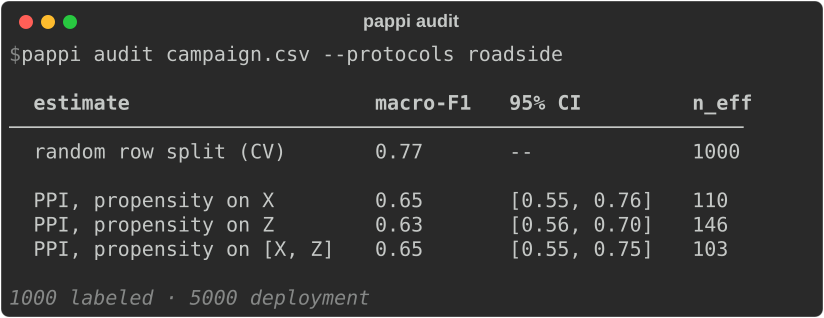

# PaPPI

Crop maps are usually evaluated on labels collected near roads or in a few survey areas, so the
reported score can overstate performance on the area the map covers. PaPPI (Protocol-aware
Prediction-Powered Inference) estimates a model's macro-F1 or accuracy on the whole deployment
area, with a confidence interval, from those biased labels plus unlabeled deployment points.



## Setup

Python 3.10 or newer.

```console
$ pip install "pappi[geo] @ git+https://github.com/microsoft/PaPPI"
```

Drop `[geo]` if your table already holds its bias covariates; the extra adds the
OpenStreetMap and Copernicus DEM fetchers. For the exact versions this release was tested with:

```console
$ git clone https://github.com/microsoft/PaPPI && cd PaPPI
$ pip install -r requirements.txt
$ pip install --no-deps .
```

## Run

On your own campaign (columns under [Input](#input)):

```console
$ pappi audit my_campaign.csv
```

Or on a synthetic roadside campaign with known truth, no downloads, about 10 seconds:

```console
$ python examples/quickstart.py
```

Random CV scores the near-road labels; the PPI rows estimate the score on all deployment rows,
and the last line prints that score from the hidden labels.

To audit a model you already trained, make the labeled rows a test set it never saw:

```console
$ pappi audit test_and_deploy.csv --model my_model.joblib
```

## Input

One row per sample. Rows with a `label` are your labeled set; rows with an empty `label` are a
uniform sample of the deployment population. `--label` and `--features` rename the columns.

| column | meaning |
|---|---|
| `label` | class name; empty = deployment row |
| `x_*` | model features |
| `lat`, `lon` | switch on geo defaults in the CLI: the four fetchable protocols |
| Z columns, e.g. `dist_to_road`, `elevation` | bias covariates: what drove labeling, named by a protocol; geo ones are fetched from OSM / Copernicus DEM when absent |

## Python

```python
from sklearn.linear_model import LogisticRegression
from pappi import Accuracy, Bootstrap, Dataset, Protocol, audit
import pappi.geo as geo                              # registers the geo protocols

data = Dataset.from_csv("my_campaign.csv")
report = audit(data, **geo.defaults(data))           # what the CLI does for lat/lon data

def fit_logreg(X, y):                                # any trainer: returns predict_proba
    return LogisticRegression(max_iter=1000).fit(X, y)

report = audit(Dataset.from_files("labels.parquet", "deploy.parquet"),
               fit_model=fit_logreg,
               protocols=[Protocol("referral", z=["distance_to_clinic"])],
               inclusion="p_selected",                     # or a function frame -> probabilities
               interval=Bootstrap(200), metric=Accuracy())
report.frame                                          # one row per estimate

report = audit(Dataset.from_files("test.parquet", "deploy.parquet"), model=my_model,
               protocols=[Protocol("referral", z=["distance_to_clinic"])])
```

- `Dataset`: `from_csv`, `from_files(labeled, deploy=None)` (csv/parquet/feather), `from_frame`.
- `protocols`: `Protocol(name, z)` or a registered name (`roadside`, `settlement`, `elevation`, `slope`, `region`, `size` after `import pappi.geo`); each Z is a column name or a pair `(name, fn)` with `fn(frame) -> array`, computed only if the column is missing.
- `Split(name, groups, assign)`: how rows are split into folds. `groups` is a column name or `(name, fn)`; rows sharing a group share a fold. `assign(n, groups) -> fold id per row` (default `kfold`: each row, or each whole group, gets a random fold out of `folds`).
  - `in_domain`: the CV rows of the table (default: one random row split).
  - `correction_split`: held-out predictions for the PPI correction (default: `in_domain[0]`).
  - `propensity_split`: folds for the labeled-vs-deployment model over both row sets.
- `inclusion`: known inclusion probabilities (a column, or `frame -> array`), needed up to a constant; adds a "known inclusion" row.
- `interval=Bootstrap(n, groups, arms)`: percentile intervals from resampled labels (or label clusters, with `groups`), refitting the propensity each time. `arms` (e.g. `("x",)`) limits which rows get one; an IWCV row follows its PPI arm (`"x"` also covers `iwcv_x`). Stored as `boot_lo`/`boot_hi` and shown in the table. The default is the faster delta interval, which treats labels as independent and the weights as fixed; the bootstrap does not.
- `iwcv=True`: after each PPI row, an IWCV row (importance-weighted CV; key `iwcv_<arm>`) with the same weights but no deployment predictions: the weighted score of the held-out labels. In the paper it is nearly as accurate as PPI, with slightly higher per-run error.
- `metric`: `MacroF1()` (default), `Accuracy()`, or any object with `observed`, `expected`, `value`, `grad`, `score`.
- `fit_model`, `fit_propensity`: functions `fit(X, y)` returning an object with `predict_proba(X)` (columns = classes 0..K-1); called once per fold, so the tool never needs your model class. Default: XGBoost with the paper's settings.
- `model`: a trained model audited as is, instead of `fit_model`: an object with `predict_proba(X)` or a function `f(X) -> probabilities` (CLI `--model pkg.module:obj`, or a `.pkl`/`.joblib`; loading one runs its code, so use trusted files only). The labeled rows must be a test set it never saw, or the estimate comes out optimistic; the tool cannot check this. The model is never retrained: one "test set (as reported)" row replaces the CV rows. Columns of `predict_proba` must follow the sorted labels (checked when the model has `classes_`); a model fitted on named columns gets them by name.
- `report.models`: the models behind the PPI rows: the correction split's fold models by default, or `[your object]` with `model` (wrapped if it is a function or was fitted on named columns). Call them on `report.data.X`; `report.data` holds only the rows the audit kept.
- `folds=5`: k of every default (`kfold`) split; each fold model trains on (k-1)/k of the labels. A custom `assign` keeps its own k.
- `n_jobs`: parallel processes for the bootstrap replicates; the same results for any value.
- `light=True` caps deployment at a random 2,000 rows (the caption says how many of how many) and uses 50 boosting rounds; `progress=True` shows a progress bar (on in the CLI).

Geo defaults (`geo.defaults`, applied by the CLI when the table has `lat`/`lon` and you set no `protocols`): the four fetchable protocols `roadside`, `settlement`, `elevation`, `slope`.

CLI flags: `--fit-model pkg.module:fit`, `--fit-propensity pkg.module:fit`, `--model pkg.module:obj`, `--folds K`, `--jobs J`, `--inclusion COL`, `--bootstrap N`, `--metric accuracy`, `--iwcv`; in `--config`, `<key>_params` calls `fit_model`, `model` or `fit_propensity` as a factory with those arguments.

A `--config` YAML sets the same keys plus custom protocols and splits:

```yaml
label: band
model: my_model.joblib
protocols:
  - {name: enrolment, z: [formal_sector, km_to_office]}
bootstrap: 500
jobs: 8
```

## Geo covariates

Each covariate pairs a source (acquire) with a derivation (compute at points) and returns a `(name, fn)` pair:

```python
geo.DistanceTo(geo.LocalVector("my_roads.gpkg"), "dist_to_road")
geo.SampleRaster(geo.LocalRaster("my_dem.tif"), "elevation")
geo.SlopeOf(geo.CopernicusDEM(), "slope")
```

Sources: `GeofabrikLayer(layer, fclass)`, `LocalVector(path)`, `CopernicusDEM()`, `LocalRaster(path)`; downloads are cached under `~/.cache/pappi`.

## Output

CV rows: in-domain cross-validation on the labels; with `model`, one "test set (as reported)" row
instead. PPI rows: deployment estimate with the propensity model fit on X, Z, or both; `n_eff` is
the effective number of labels behind it. IWCV rows (with `iwcv`) reweight the held-out labels
with the same weights and skip the deployment predictions. The caption lists counts and notes such as
`light mode: 2,000 of 5,000 deployment rows`. `report.frame` holds one row per estimate with the
propensity `auc` (near 1: labeled and deployment rows barely overlap), medians, and
`q_clip_share_l` (share of labels whose propensity hits the 1e-3 clip).

## Assumptions

- Each PPI or IWCV row assumes that, given the covariates its propensity uses (X, Z, or both), whether a
  row was labeled does not depend on its label.
- Every kind of deployment row has some chance of being labeled. Where it has none, weights hit
  the clip and `n_eff` falls.
- Deployment rows are a uniform sample of the population the estimate is about.
- With `model`, the labeled rows were not used to train it.
- With `fit_model`, the PPI rows estimate the mean deployment score of the correction split's
  fold models, each trained on (k-1)/k of the labels: every fold model predicts the deployment
  rows and is corrected on the labels it did not see. A model refit on all labels usually
  scores a little higher.
- Labels are classes; the metrics are macro-F1 and accuracy.

## Tests

```console
$ pip install pytest && pytest
```

## Data and licenses

The repository holds no data: the demo campaign is generated by `pappi.demo`. With `[geo]`,
PaPPI downloads OpenStreetMap (© OpenStreetMap contributors, ODbL) and Copernicus DEM GLO-30
(© DLR e.V., © Airbus Defence and Space GmbH, provided under COPERNICUS by the EU and ESA)
on your machine. Code is MIT-licensed ([LICENSE](LICENSE)); third-party packages and data
attributions are listed in [THIRD_PARTY_NOTICES.md](THIRD_PARTY_NOTICES.md).

Network use: with `[geo]`, PaPPI sends the bounding box of your points (never labels, features
or the points themselves) to the Planetary Computer STAC API to find DEM tiles, then reads
those tiles and the Geofabrik extracts that cover the box. Downloads are cached under
`~/.cache/pappi`. To make no requests, put the Z columns in your table or use `LocalVector` /
`LocalRaster`.

## Citation

```bibtex
@misc{zaytar2026pappi,
  title  = {Crop Mapping Evaluation under Sampling Bias},
  author = {Zaytar, Akram and Ochwang'i, Kemunto and Robinson, Caleb and Tadesse, Girmaw A.
            and Hacheme, Gilles Q. and Dodhia, Rahul and Becker-Reshef, Inbal
            and Lavista Ferres, Juan M.},
  year   = {2026},
}
```

## Contributing

This project welcomes contributions and suggestions. Most contributions require you to agree to a
Contributor License Agreement (CLA) declaring that you have the right to, and actually do, grant us
the rights to use your contribution. For details, visit https://cla.opensource.microsoft.com.

When you submit a pull request, a CLA bot will automatically determine whether you need to provide
a CLA and decorate the PR appropriately (e.g., status check, comment). Simply follow the
instructions provided by the bot. You will only need to do this once across all repos using our CLA.

This project has adopted the [Microsoft Open Source Code of Conduct](https://opensource.microsoft.com/codeofconduct/).
For more information see the [Code of Conduct FAQ](https://opensource.microsoft.com/codeofconduct/faq/) or
contact [opencode@microsoft.com](mailto:opencode@microsoft.com) with any additional questions or comments.

Authors are listed in [AUTHORS.md](AUTHORS.md). See [SUPPORT.md](SUPPORT.md) for help and
[SECURITY.md](SECURITY.md) to report a vulnerability.

## Trademarks

This project may contain trademarks or logos for projects, products, or services. Authorized use of
Microsoft trademarks or logos is subject to and must follow
[Microsoft's Trademark & Brand Guidelines](https://www.microsoft.com/en-us/legal/intellectualproperty/trademarks/usage/general).
Use of Microsoft trademarks or logos in modified versions of this project must not cause confusion
or imply Microsoft sponsorship. Any use of third-party trademarks or logos is subject to those
third-party's policies.
